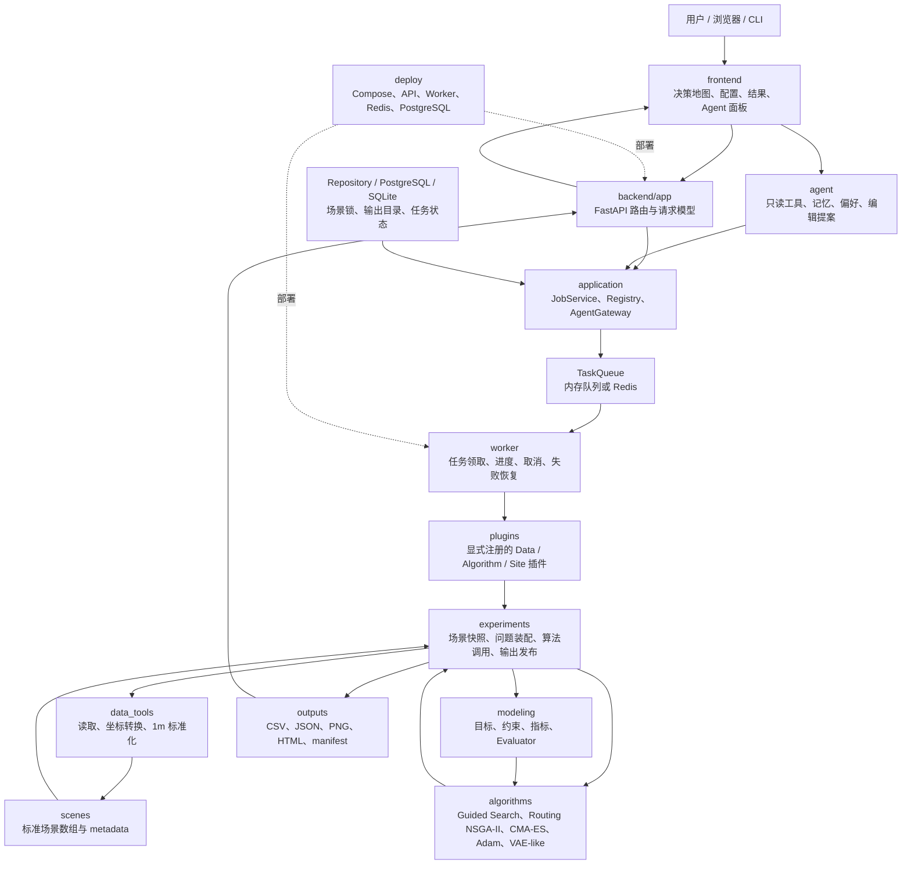
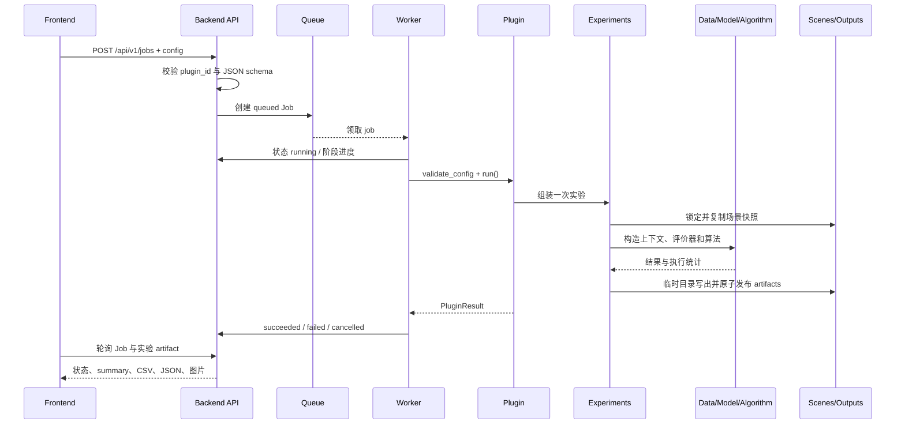
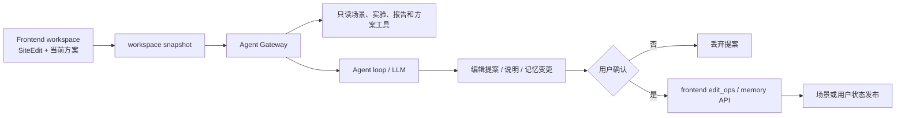

# v0 软件框架

## 文档定位

v0.1 最初只验证软件骨架和插件边界：浏览器通过 FastAPI 提交一个任务，Worker 从队列领取任务，
插件执行后将状态和结果写回数据库，前端查询并展示结果。deterministic demo plugin 仍保留用于外壳回归，
但当前仓库已经接入真实 DEM、landuse、道路、场景、选址和选线实验。本文件先说明共享的软件外壳和当前系统边界，
算法内部口径继续由各算法文档维护。

## 目录边界

选线模块化改造保持现有 Jobs/Worker/HTTP 协议。任务配置在不依赖插件实现的配置模块维护，插件与 CLI/实验共同引用；旧导入名兼容保留。运行结果数据类型不放在搜索入口，输出写入只依赖结果契约。公共输出目录处理由输出工具维护，选线运行器不再导入站址运行器。算法组件只在算法内部显式装配，不增加后端任务服务的算子分支。

```text
frontend/       React + TypeScript 页面和 API client
backend/app/    FastAPI、领域协议、用例和基础设施适配器
worker/         后台任务执行入口
plugins/        显式注册的内置插件
agent/          只读工具和编辑提案。确认前不改地图，也不提交搜索
experiments/    实验上下文、标准输出和 artifact 编排
data_tools/     数据读取和转换模块
modeling/       目标、约束、指标和 evaluator 模块
algorithms/     引导式多目标搜索、CMA-ES、Adam 和 VAE-like 算法模块
deploy/         Docker Compose 部署文件
masking_pipeline/ 按坐标生成四份站点数据的流水线；不单独提供 Web 服务
```

## 当前系统总架构

本节描述仓库当前的实际运行边界。v0.1 的 deterministic demo 仍用于验证软件外壳，
但真实场景、选址和选线已经通过同一套 Jobs、Worker、插件和实验输出协议接入。
系统按“交互与任务 → 实验装配 → 科研计算 → 场景与产物”分层；上层只调用下层的明确接口，
不把算法实现写进 API 或前端。



### 一级模块职责

| 一级模块 | 主要职责 | 关键边界 |
| --- | --- | --- |
| `frontend/` | 展示地图、编辑问题、提交任务、查看实验和方案 | 不读取 `outputs/`，不实现目标函数或搜索算法 |
| `backend/app/` | HTTP、任务用例、插件注册、任务状态和基础设施适配 | 不直接实现算法，不在路由里读取科研矩阵 |
| `worker/` | 在后台执行插件，报告阶段、处理取消和失败 | 不处理 HTTP，不决定算法细节 |
| `plugins/` | 把稳定插件 ID、schema 和 `run()` 接到任务系统 | 通过显式注册发现，不做动态算法扫描 |
| `experiments/` | 把场景、配置、建模和算法组装成一次可复现实验 | 负责快照、缓存、结果写出和原子发布 |
| `data_tools/` | 生成统一坐标和 1 m 栅格数据 | 不训练算法，不计算优化目标 |
| `modeling/` | 提供目标、硬约束、后验指标和统一 evaluator | 不读取原始 tif/csv/GeoJSON |
| `algorithms/` | 生成候选、搜索、选择和优化 | 不读取原始数据，不重写建模公式 |
| `agent/` | 读取当前工作区并提出编辑方案 | 用户确认前不改地图，不直接提交搜索 |
| `scenes/` / `outputs/` | 保存标准场景和完成实验产物 | 通过版本、哈希、锁和临时目录保证一致性 |

### 依赖方向

```text
frontend
  → backend/app API
  → application / domain protocols
  → worker + plugins
  → experiments
  → data_tools / modeling / algorithms
  → scenes / outputs
```

科研计算层的内部方向是：

```text
data_tools → modeling → algorithms
      \\          ↓          /
       └──── experiments ───┘
```

`experiments/` 是组合层：它读取场景产物、构造 `ProblemContext`，把 `modeling` 的 evaluator
传给 `algorithms`，然后把结果写成标准 artifact。`algorithms` 不反向调用 `experiments`。

### 跨模块数据对象

| 数据对象 | 生产者 | 消费者 | 内容 |
| --- | --- | --- | --- |
| `SceneBundle` | `data_tools/`、`scene_store.py` | `experiments/`、只读 API、地图 | DEM、landuse、道路、可选永农掩膜、坐标帧、版本和来源 |
| `TaskConfig` | 前端 schema/API、CLI | `plugins/`、`experiments/`、算法配置 | 场景、用户约束、算法参数、设备、seed、输出名 |
| `ProblemContext` | `experiments/` + `modeling/` | `algorithms/`、单点重算、报告 | 对齐数组、坐标范围、约束掩膜、缓存和 evaluator |
| `Evaluator` | `modeling/` | `algorithms/`、报告、复核 | 候选解 → objectives、feasibility、hard metrics |
| `AlgorithmResult` | `algorithms/` | `experiments/` | 候选、Pareto 集、评价次数、执行信息、停止原因 |
| `ExperimentArtifacts` | `experiments/` | backend artifact API、frontend | CSV、JSON、图片、HTML、summary、输入快照 |
| `AgentWorkspaceSnapshot` | frontend Agent 模块 | `agent/`、Agent Gateway | 当前编辑、候选、偏好、场景和选择记录 |

### 实验任务时序



### Agent 数据流

Agent 是交互辅助层，不是算法执行层：



Agent 可以读取场景、实验和报告，但不直接修改算法参数、提交 Job 或写地图；确认后的具体写入仍由前端和后端既有接口完成。

前端内部继续按功能模块组织：`App.tsx` 是应用外壳，导航为“问题与运行 / 实验结果”。
`problem_overview.tsx` 展示问题概览，`problem_snapshot.ts` 把实验产物适配成只读快照。
`job_workspace.tsx` 负责任务提交，`run_monitor.tsx` 单独轮询任务状态，`experiment_browser.tsx` 和 `result_explorer.tsx` 负责只读实验结果，
`config_form.tsx` 负责 JSON Schema 配置表单。详细文件地图见
`markdown/CODE_MAP.md`。

API 层不读取算法代码，Worker 不处理 HTTP，插件不读取数据库。跨层数据通过明确的 Python 类型和 JSON schema 传输。

## 任务流

1. `POST /api/v1/jobs` 校验插件 ID 和配置。
2. API 创建 `queued` 任务并将 `job_id` 放入任务队列。
3. Worker 领取任务，更新为 `running`。
4. 插件通过 reporter 写入进度、阶段和消息。
5. 插件返回结构化结果，Worker 将任务更新为 `succeeded`；异常则更新为 `failed`。失败阶段留在任务的 `stage` 上；没有阶段信息时记为 `failed`。
6. 前端通过 `GET /api/v1/jobs/{job_id}` 查询状态，通过 `/result` 查询结果。刷新页面后仍读取同一条任务记录。
7. `POST /api/v1/jobs/{job_id}/cancel` 将排队任务直接取消，运行任务改为 `cancelling`，执行器到检查点退出后才确认为 `cancelled`。取消中仍占用场景，进度检查和发布前检查不得省略。任务失败的公开响应不含 traceback；完整堆栈只写服务端日志。

部署只允许一个 Worker（含内置 Worker），用共享输出目录下的 `user-state/worker.lock` 系统锁独占。持锁启动时将遗留运行任务标失败、取消中任务确认取消，重新入队 queued；原子领取保证重复队列消息不重复执行。不会自动重跑已运行任务。

`site.build_scene` 使用这条阶段序列：`generating_data`、`validating_data`、`rebuilding_scene`，成功后阶段为 `ready`。路径、QA 和失败时保留旧数据包的规则写在 `markdown/DATA_MODULE_SUMMARY.md`。它不新增任务系统。

开发测试默认使用内存 SQLite 和内存队列，API 在同一进程启动内置 Worker。设置 `DATABASE_URL=sqlite:///outputs/v0/jobs.db` 后可使用文件 SQLite。Docker Compose 使用 PostgreSQL、Redis 和独立 Worker，具体适配由 Repository 和 TaskQueue 接口隔离。

## 插件协议

每个插件提供：

- 稳定的 `id` 和 `version`
- `describe()` 返回名称、类型、说明和配置 schema
- `validate_config()` 校验配置
- `run()` 执行任务并返回 `PluginResult`

插件通过显式注册表发现。新增插件只需实现协议并在组合根注册，不修改任务服务、API 路由或前端任务页面。

`PluginSpec.config_schema` 是配置表单的唯一来源。前端根据该 JSON Schema
渲染对象、字符串、数字、布尔值、枚举和基础数组字段，并在提交前按 schema
归一化配置；新增插件字段不需要修改 `App` 或 API 路由。`create_app` 接受显式
`PluginRegistry`，因此测试、实验入口和部署组合根都可以注入不同插件集合。

`JobService` 只依赖 `PluginRegistry`、`JobRepository` 和 `TaskQueue` 接口。
内存/SQLite、PostgreSQL 和 Redis 实现位于基础设施适配器中，插件不会依赖数据库
或 HTTP；这使得同一个插件可以在本地测试、嵌入式 worker 和独立 worker 中复用。

`site.partitioned_guided_search` 是一个普通 Job 插件，通过现有 Jobs API 提交并由单个 Worker 执行。它在实验层把安全搜索中心范围切成 4 或 6 个矩形分区，对同一全局场景和 HaulField 运行有界的 Guided Search；`max_parallel_tiles` 限制插件内部并发。所有子搜索完成后以全局坐标重算、合并候选并输出一个标准实验目录。它不新增前端交互或 Job/Queue 数据模型；分区和输出契约见 `markdown/GUIDED_SEARCH.md`。

后续插件类型包括：

- `DataTool`：生成统一 1 m 局部栅格和数据 manifest
- `AlgorithmPlugin`：执行优化算法
- `ObjectivePlugin`：计算 soft objective
- `ConstraintPlugin`：计算 hard feasibility 和约束
- `MetricPlugin`：生成后验指标

## v0.1 API

- `GET /api/v1/health`
- `GET /api/v1/plugins`
- `GET /api/v1/experiments`
- `POST /api/v1/experiments`
- `GET /api/v1/experiments/{experiment_id}`
- `GET /api/v1/experiments/{experiment_id}/artifacts/{artifact_id}`
- `DELETE /api/v1/experiments/{experiment_id}`
- `POST /api/v1/jobs`
- `POST /api/v1/jobs/{job_id}/cancel`
- `GET /api/v1/jobs/{job_id}`
- `GET /api/v1/jobs/{job_id}/result`
- `GET /api/v1/scenes`
- `GET /api/v1/scenes/{scene_id}/landuse-overlay/{layer}`
- `GET /api/v1/scenes/{scene_id}/obstacle-overlay`
- `GET /api/v1/scenes/{scene_id}/map-layers`
- `GET /api/v1/scenes/{scene_id}/dem-overlay`
- `GET /api/v1/scenes/{scene_id}/road-segments`
- `POST /api/v1/scenes/{scene_id}/data-import/preview`（multipart：可选 farmland、roads，外部道路须 provider）
- `GET /api/v1/scenes/{scene_id}/data-import/preview/{token}/farmland.png`
- `GET /api/v1/scenes/{scene_id}/data-import/preview/{token}/roads`
- `POST /api/v1/scenes/{scene_id}/data-import/confirm`（token）
- `POST /api/v1/scenes/{scene_id}/data-import/restore-osm`
- `DELETE /api/v1/scenes/{scene_id}/protected-farmland`
- `GET /api/v1/scenes/{scene_id}/protected-farmland-overlay`
- `POST /api/v1/scenes/{scene_id}/landuse-patch`
- `POST /api/v1/scenes/{scene_id}/site-report`
- `POST /api/v1/scenes/{scene_id}/pose-objectives`
- `POST /api/v1/scenes/{scene_id}/construction-feasibility-overlay`
- `GET /api/v1/scenes/{scene_id}/favorites`
- `POST /api/v1/scenes/{scene_id}/favorites`
- `PUT /api/v1/scenes/{scene_id}/favorites/{favorite_id}`
- `DELETE /api/v1/scenes/{scene_id}/favorites/{favorite_id}`

删除收藏成功返回 HTTP 204 空响应；路由显式禁用响应模型，避免 FastAPI 从返回注解推导响应体而阻断应用启动。

收藏场景身份支持固定预置项和 `SCENE_ROOT` 下已发布全部标准产物的动态场景；只检查受控路径和产物存在性，不读取大矩阵，不要求动态场景出现在原始输入的固定映射中。收藏创建与单点评价分开，保存请求不触发建场或优化。
- `POST /api/v1/agent/chat`
- `GET /api/v1/agent/ops`
- `GET /api/v1/agent/settings`
- `PUT /api/v1/agent/settings`
- `GET /api/v1/agent/memory`
- `POST /api/v1/agent/memory`
- `GET /api/v1/agent/preferences`
- `PUT /api/v1/agent/preferences/defaults`
- `POST /api/v1/agent/preferences/choices`

`GET /scenes` 固定返回 `cangnan`（苍南）和 `yongjia`（永嘉），即使后者尚未构建。每项包含 `ready`、`missing`、显示名和地图 frame；就绪 frame 来自场景 metadata，未就绪预览 frame 来自该场景真实 reference GeoTIFF 与 landuse shape。`site.prepare_scene` 接受当前场景 id。苍南、永嘉使用 `experiments/scene_store.py` 中受控的四文件路径；其他已发布场景使用该目录 `scene.json` 记录的原始文件。构建在私有临时目录完成后发布；失败不产生 ready 场景。已 ready 场景在普通打开时直接复用；`rebuild: true` 会重新生成并融合官方水系。具体输入路径和发布口径见 `markdown/DATA_MODULE_SUMMARY.md`。

`/scenes/{scene_id}/pose-objectives` 接收决策搜索的约束字段（`searchConfig()` 去掉 `scene_name`）和至多 200 个解码后的 `{x, y, theta}`，按 `experiments.launch_site_run.evaluate_form_poses` 返回与 `solutions.csv` 同列的记录。它不提交任务。Worker 在优化阶段把进站距离场的安全数组缓存发布到 API 与 Worker 共享的场景卷；`pose-objectives` 与 `site-report` 按 `markdown/MODELING_MODULE_SUMMARY.md` 的原点绑定与失效规则跨进程复用。API 仍保留进程内 LRU；共享缓存缺失、损坏或版本不兼容时回退到原有构建流程。两个接口只在读取场景文件快照时持有场景锁，距离场在锁外读取或构建；同一缓存键用 `.haul_field_cache/.building/<key>.lock` 跨进程只构建一次，后到者等前者写完再读盘。`site-report` 进程内缓存命中不取场景锁。`POST /jobs` 取场景锁最多等待 30 s（`SUBMIT_SCENE_LOCK_WAIT_SECONDS`），仍被占用时返回 409 `scene_busy`，不再报 422。两个接口的日志都输出分段耗时：`pose_objectives total_s/scene_s/eval_s` 与 `pose_objectives scene_build problem_s/field_s`，`site_report total_s/field_s/...`。前端何时调用见 `markdown/FRONTEND_IMPLEMENTATION_SPEC.md` 7.5。

`/scenes/{scene_id}/construction-feasibility-overlay` 接收当前山地/农田策略及手绘禁区、可行域，只读加载场景 `landuse_1m.npy`，复用优化器的约束掩膜组合函数，并返回红绿二值 RGBA PNG。它不创建任务，不写场景或实验文件，也不改变优化约束；绿色仅表示对应 1 m 地表网格未被当前 hard mask 阻止。

`/scenes/{scene_id}/favorites` 为人工点选与优化结果提供同一套独立收藏 CRUD。API 只传经纬度、长宽快照和北向顺时针方位角，不参与算法、`SiteEdit` 或 Agent。SQLite 文件由 `FAVORITES_DB_PATH` 配置，默认 `outputs/user-state/favorites.sqlite3`；默认路径和环境变量中的相对路径均相对于仓库根目录，放在场景目录之外以免场景重建覆盖。当前无用户认证，同一服务的用户共享收藏。字段、坐标、持久化和地图交互口径见 `markdown/FRONTEND_IMPLEMENTATION_SPEC.md` 7.5。

三个地图图层 GET 接口都是只读可视化服务。`map-layers` 返回 DEM、四类 landuse 图片和当前道路段（含供应来源、道路产品 id 和永农内容哈希）的可用状态及 DEM 真实高程范围；`dem-overlay` 返回由对齐后 DEM 生成的缓存 PNG；`road-segments` 返回既有 `[x1, y1, x2, y2]` 局部米坐标与逐段 `kinds`，道路到 WGS84 的显示转换仍统一由前端 `SiteFrame` 完成。这些接口不改变场景数组、优化配置或实验结果，DEM 图片缺失也不改变场景就绪状态。

`/agent/chat` 接收当前工作区快照和对话，返回说明以及可选的编辑提案。提案里的操作清单、校验和确认流程以 `markdown/AGENT_MODULE.md` 为准。`/agent/ops` 只返回这组操作的 JSON Schema。`/agent/settings` 管理长期记忆开关和私密模型配置，写操作不需要管理员密码；GET 不返回 API Key。记忆和偏好的写接口只在用户确认或点击后调用，口径同样以 `markdown/AGENT_MODULE.md` 为准。部署时只有 API 挂载忽略提交的 `memory/` 目录，用于保存设置、文字记忆与偏好记录。

任务状态为 `queued`、`running`、`cancelling`、`succeeded`、`failed`、`cancelled`。实验目录扫描
`EXPERIMENT_OUTPUT_ROOT`（默认 `outputs/`）下包含 `run_summary.json` 的直接子目录，
并通过安全 artifact URL 提供 PNG、HTML、JSON 和 CSV。界面搜索先在输出根目录下的临时子目录生成完整产物，成功后再整目录发布到实验名称对应的位置；`resolved_config.json` 中仍记录最终输出路径。覆盖同名实验时，计算或写出失败保留原实验的配置、方案和完成标记；发布替换失败时恢复旧目录。成功覆盖不保留上一种算法的残余文件，例如 `runs.csv`。`DELETE /api/v1/experiments/{experiment_id}`
只删除这样一个已完成目录，不能通过路径离开输出根目录，也不会删除没有 `run_summary.json` 的目录。API 容器必须能写入 `outputs/`，只读挂载会让确认删除失败。
`POST /experiments` 手动另存当前工作区，接收名称、场景、完整评价约束和保留方案的 id、位姿、手动标记、层级与局部优化来源。后端拒绝忙碌场景，复用现有评价器重新计算目标和可行性，在输出根目录的私有临时目录写入 CSV、场景/约束引用与 `workspace_solutions.json`，完整完成后原子发布为独立案例。目录 id 由服务端生成，显示名称存入摘要，同名不覆盖。目录扫描忽略私有临时目录。新案例可通过原有列表、artifact 和删除接口管理；其工作区文件保留全部方案而不按当前可行性再次筛掉。交互口径见前端权威文档。

任务生成的插件 artifact 后续应复用同一 manifest 结构。正式身份认证、数据集版本管理和真实
算法接入在后续增量中实现。

旧的 protected-farmland 预览与确认接口已移除。统一导入的备份、版本核对、发布保护与回滚契约以 `markdown/DATA_MODULE_SUMMARY.md` 为准。有运行或排队任务时拒绝导入与恢复。API 镜像通过 `backend/requirements-data.txt` 安装同步数据处理依赖，API 与 worker 都需要 libarchive-tools 解压 RAR。

前端 Nginx 代理允许 170 MiB 请求体，覆盖一次两份各不超过 80 MiB 的道路与永农上传及 multipart 开销；`proxy_read_timeout` 为 300 s，以覆盖同步预览及报告计算。单文件实际限制仍由 API 校验，代理放大上限不放宽单文件规则。

任务进度仅允许从 running 状态写入；取消或完成后迟到的回调不能覆盖阶段、文案或更新时间。插件自定义的成功阶段与结果在同一次条件更新中提交，不再成功后另写一次进度。

## 选线任务接入

`routing.nsga2` 通过现有 Jobs API 注册，配置为 `plugins/routing_plugin.py` 的 `RoutingRunConfig`，两端经纬度、最大水平档距、塔基半径、最大转角必填。它复用 Worker、取消、场景占用、实验目录和 artifact 查询，不新增队列或任务状态。`plugins/schema.py` 与站址共用嵌套 schema 展开。

`experiments/launch_routing_run.py` 在场景锁内保存独立输入快照，之后只读计算；输入哈希及数据版本保存在 metadata。`routes.json` 保存有序线路和报告，`run_summary.json` 的 `problem_type=routing` 区分站址。`experiments/output_writer.py` 的 `staged_experiment` 由两类实验共同使用，发布失败恢复原目录；发布前进度回调是取消检查点。净空未校核。
